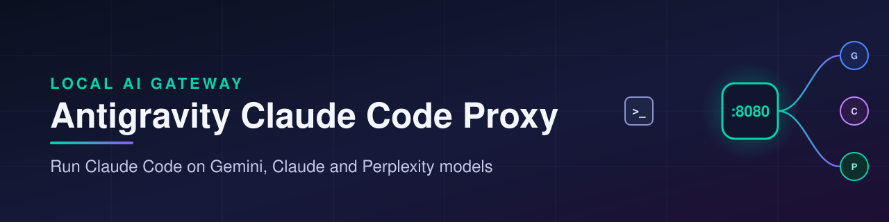
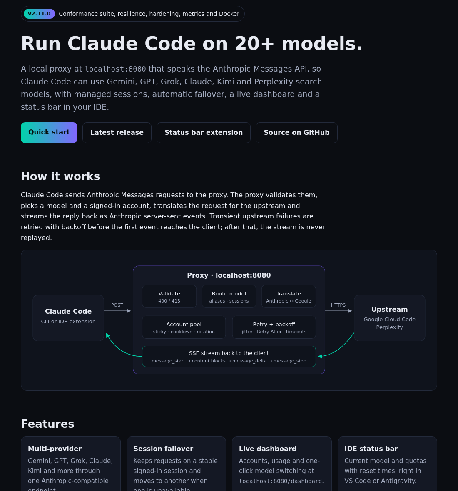
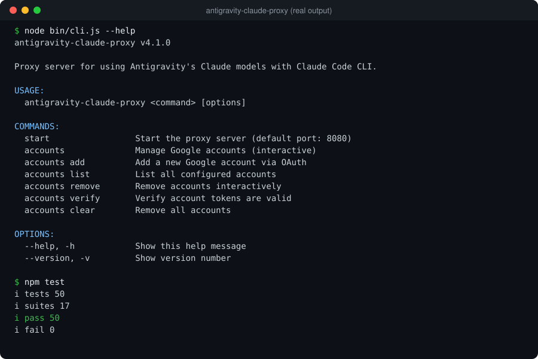
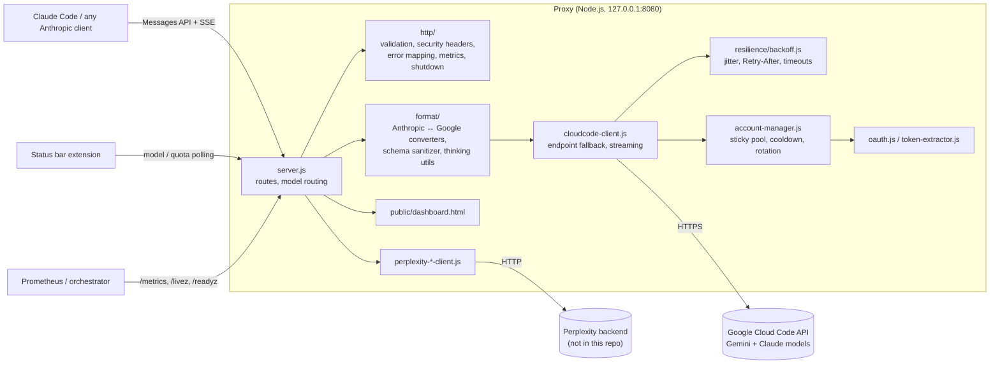
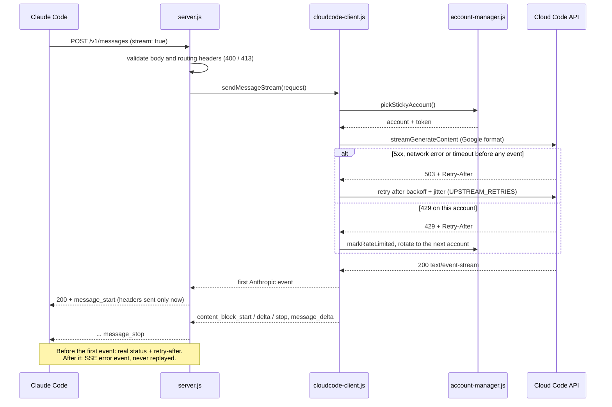

<p align="center">
  
</p>

<p align="center"><strong>Run Claude Code on Gemini, Claude and Perplexity models through one local, Anthropic-compatible endpoint.</strong></p>

<p align="center">
  <a href="https://github.com/muhib-karim/Antigravity-Claude-Code-Proxy/actions/workflows/ci.yml"></a>
  <a href="https://github.com/muhib-karim/Antigravity-Claude-Code-Proxy/actions/workflows/codeql.yml"></a>
  <a href="Antigravity-Claude-Code-Proxy/.c8rc.json"></a>
  <a href="https://github.com/muhib-karim/Antigravity-Claude-Code-Proxy/releases/latest"></a>
  <a href="LICENSE"></a>
  
  <a href="Antigravity-Claude-Code-Proxy/Dockerfile"></a>
  <a href="https://open-vsx.org/extension/ai-dev-2024/claude-proxy-status"></a>
</p>

<p align="center">
  <a href="https://muhib-karim.github.io/Antigravity-Claude-Code-Proxy/">Website</a> •
  <a href="#quick-start">Quick start</a> •
  <a href="#run-with-docker">Docker</a> •
  <a href="#architecture">Architecture</a> •
  <a href="#configuration">Configuration</a> •
  <a href="#testing">Testing</a> •
  <a href="#security">Security</a> •
  <a href="#upstream-and-what-this-fork-adds">What this fork adds</a>
</p>

Based on [antigravity-claude-proxy](https://github.com/badrisnarayanan/antigravity-claude-proxy) by Badri Narayanan S (MIT License).

---

## What it is

Antigravity Claude Code Proxy is a local Node.js/Express gateway. It speaks the **Anthropic Messages API** (`/v1/messages`, with SSE streaming), so Claude Code and other Anthropic clients only need `ANTHROPIC_BASE_URL` pointed at it. It translates each request into the format the upstream provider expects, sends it with the signed-in account it picked, and translates the response (text, tool calls and thinking blocks) back.

### Key features

- **Anthropic-compatible API**: `/v1/messages` (streaming and non-streaming), `/v1/messages/count_tokens` and `/v1/models`.
- **Two-way format translation** (`src/format/`): messages, system prompts, images/documents, tool calls and results, and thinking blocks with signature handling. Also includes a JSON-schema sanitizer for tool definitions the Cloud Code API would otherwise reject.
- **Multi-account handling**: Google accounts added through OAuth are stored owner-only (`0600`). Requests use a sticky account for caching, accounts are rotated with cool-downs when rate-limited, and requests fail over when a token refresh fails.
- **Model routing**: 37 built-in short aliases (`flash`, `pro`, `opus`, …), a global model override (`/active-model`), and per-session models via the `X-Session-ID` header (`/session-model`).
- **Web dashboard** at `/dashboard`: accounts, quotas, usage per model, sessions and model switching.
- **Local-only by default**: binds to `127.0.0.1` and refuses foreign `Origin` headers and DNS-rebinding style `Host` headers.
- **CLI** (`bin/cli.js`): start the server and manage accounts (`add`, `list`, `remove`, `verify`, `clear`). `scripts/doctor.js` runs a setup self-check.
- **Resilient upstream calls** (v2.11.0): exponential backoff with jitter, `Retry-After` honoured, bounded timeouts, no replay of a started stream, cancellation when the client disconnects, and graceful shutdown that drains open streams.
- **Operable**: `/livez`, `/readyz` and Prometheus `/metrics`; a multi-stage Docker image that runs as a non-root user.
- **Verified offline**: a 37-fixture Anthropic conformance suite plus unit and integration tests (222 in total) run against a mock upstream on every push.
- **Status bar extension** for VS Code-based editors, [published on Open VSX](https://open-vsx.org/extension/ai-dev-2024/claude-proxy-status). It shows the active model and quotas and allows one-click switching.

> **Verification scope.** CI runs lint, format and type checks, the offline suites under an 80% coverage gate on Node 22 and 24 against mocked upstreams, a Docker build and smoke run, CodeQL, secret scanning and a runtime dependency audit. Those checks do not establish current access to every remote model or account. Provider names and model identifiers can change; verify the configured provider before relying on it.
>
> The gateway runs locally, but prompts and code sent for inference are forwarded to the configured provider. Account credentials, OAuth setup and provider quotas are your responsibility. Do not publish credentials, logs with tokens, or real account screenshots in a public issue. A static showcase or mocked test is not a live-provider benchmark.

### Showcase

The [project website](https://muhib-karim.github.io/Antigravity-Claude-Code-Proxy/) explains the request path and what each release verifies:

<p align="center"><a href="https://muhib-karim.github.io/Antigravity-Claude-Code-Proxy/"></a></p>

An [interactive, code-linked sequence diagram](https://muhib-karim.github.io/Antigravity-Claude-Code-Proxy/architecture/streaming-request.html) ([source](docs/architecture/streaming-request.json)) steps through one streaming request.

<details>
<summary>Terminal session, dashboard and status bar screenshots</summary>

<p align="center">
  <br><em>CLI help and the offline test run (recorded at v2.10.0, when the suite had 50 tests; it now has 222)</em><br><br>
  <br><em>Web dashboard</em><br><br>
  <br><em>Quota popup in the status bar extension</em><br><br>
  <br><em>Model switcher</em><br><br>
  <br><em>Active model in the editor status bar</em>
</p>
</details>

---

## Upstream and what this fork adds

**Upstream:** [badrisnarayanan/antigravity-claude-proxy](https://github.com/badrisnarayanan/antigravity-claude-proxy) by Badri Narayanan S, [MIT License](LICENSE). The upstream copyright notice is kept in [LICENSE](LICENSE) and credited in [NOTICE](NOTICE). Upstream provides the core gateway: the Anthropic ↔ Google format converters in `src/format/`, the Cloud Code client, the multi-account manager, OAuth account onboarding and the CLI.

Everything below was added in this repository on top of that base (`C` = commit, links go to the change).

**Earlier releases (v2.0–v2.10)**

| Area | Added | Where |
|---|---|---|
| Providers | Perplexity routing (API key, session and browser login), auto-fallback to Gemini when tools are used | [C 72a5326](https://github.com/muhib-karim/Antigravity-Claude-Code-Proxy/commit/72a5326), [C c182a3e](https://github.com/muhib-karim/Antigravity-Claude-Code-Proxy/commit/c182a3e) |
| Model routing | 37 short aliases, global override, per-session models via `X-Session-ID`, sessions dashboard | [C c182a3e](https://github.com/muhib-karim/Antigravity-Claude-Code-Proxy/commit/c182a3e), [C 2d18b89](https://github.com/muhib-karim/Antigravity-Claude-Code-Proxy/commit/2d18b89) |
| Editor integration | Status bar extension (Open VSX) and its release workflows | [C 7265a2d](https://github.com/muhib-karim/Antigravity-Claude-Code-Proxy/commit/7265a2d), [`.github/workflows/publish.yml`](.github/workflows/publish.yml) |
| Tests and CI | Offline smoke suite against a mock upstream (`tests/smoke/`), Node 20/22 CI, gitleaks, npm audit | [C 9244ca4](https://github.com/muhib-karim/Antigravity-Claude-Code-Proxy/commit/9244ca4), [C 603c9ce](https://github.com/muhib-karim/Antigravity-Claude-Code-Proxy/commit/603c9ce), [C 7c5fd03](https://github.com/muhib-karim/Antigravity-Claude-Code-Proxy/commit/7c5fd03) |
| Security | Loopback bind, Origin/Host (DNS-rebinding) checks, `0600` account files, OAuth secret moved to env, Puppeteer made optional | [C 9244ca4](https://github.com/muhib-karim/Antigravity-Claude-Code-Proxy/commit/9244ca4) |
| Docs | Project website on GitHub Pages | [C c97a889](https://github.com/muhib-karim/Antigravity-Claude-Code-Proxy/commit/c97a889), [`site/`](site/) |

**v2.11.0 (this release)**

| Area | Added | Where |
|---|---|---|
| Conformance | 30 synthetic JSON fixtures replayed against the real proxy and a scripted mock upstream: request/response mapping, SSE event order, tool_use/tool_result round-trips, system prompts, stop reasons, usage fields, 4xx/5xx/429 mapping with `retry-after`, timeouts, validation, header allow-list | [`test/conformance/`](Antigravity-Claude-Code-Proxy/test/conformance/messages.test.mjs), [`test/fixtures/conformance/`](Antigravity-Claude-Code-Proxy/test/fixtures/conformance/), [C 174caa1](https://github.com/muhib-karim/Antigravity-Claude-Code-Proxy/commit/174caa1) |
| Bugs found by the suite | Array `system` prompts (what Claude Code sends) were sent upstream as `"[object Object]"`; `stop_sequences` were dropped; `tool_result` was named after the tool id instead of the tool; tool-schema hints were duplicated and `const` was passed to Gemini; a 401 ended in "Max retries exceeded" | [C 89125c3](https://github.com/muhib-karim/Antigravity-Claude-Code-Proxy/commit/89125c3), [C 4dfe982](https://github.com/muhib-karim/Antigravity-Claude-Code-Proxy/commit/4dfe982), [C ef43636](https://github.com/muhib-karim/Antigravity-Claude-Code-Proxy/commit/ef43636) |
| Resilience | Exponential backoff with full jitter, `Retry-After` (seconds or HTTP date) honoured, up to `UPSTREAM_RETRIES` 5xx/timeout/network retries per request (timeouts retried at most once) that never replay a started stream, deadlines (504) and client-disconnect cancellation, streaming errors before the first event returned with their real status and `retry-after`, graceful shutdown that drains SSE streams | [`src/resilience/backoff.js`](Antigravity-Claude-Code-Proxy/src/resilience/backoff.js), [`src/http/shutdown.js`](Antigravity-Claude-Code-Proxy/src/http/shutdown.js), [C 6c1739e](https://github.com/muhib-karim/Antigravity-Claude-Code-Proxy/commit/6c1739e), [C 8b5ca16](https://github.com/muhib-karim/Antigravity-Claude-Code-Proxy/commit/8b5ca16) |
| Error mapping | Anthropic error types for 400/401/403/404/413/429/502/504/529 with `retry-after` | [`src/http/error-mapper.js`](Antigravity-Claude-Code-Proxy/src/http/error-mapper.js), [C 7e22f23](https://github.com/muhib-karim/Antigravity-Claude-Code-Proxy/commit/7e22f23) |
| Hardening | Request validation with one clear 400, JSON errors for malformed/oversized bodies (413), routing-header allow-list, client credentials never forwarded upstream, secret redaction for console and log file, helmet-style headers, per-client rate limit, linear-time model-switch regexes (ReDoS), no API-key fragments in logs | [`src/http/validation.js`](Antigravity-Claude-Code-Proxy/src/http/validation.js), [`src/utils/redact.js`](Antigravity-Claude-Code-Proxy/src/utils/redact.js), [`src/http/security.js`](Antigravity-Claude-Code-Proxy/src/http/security.js), [C a091d61](https://github.com/muhib-karim/Antigravity-Claude-Code-Proxy/commit/a091d61) |
| Operability | `/livez`, `/readyz`, `/metrics` (Prometheus text: requests, latency, upstream retries, account states) | [`src/http/metrics.js`](Antigravity-Claude-Code-Proxy/src/http/metrics.js), [C 7890434](https://github.com/muhib-karim/Antigravity-Claude-Code-Proxy/commit/7890434) |
| Tests | Unit tests for backoff, error mapping, redaction, validation, metrics, shutdown, account cooldown/rotation and schema cleaning; integration tests for redaction, probes, rate limiting, shutdown and management endpoints (192 offline tests in total) | [`test/unit/`](Antigravity-Claude-Code-Proxy/test/unit/), [`test/integration/`](Antigravity-Claude-Code-Proxy/test/integration/) |
| Quality gates | `// @ts-check` + `tsc --noEmit`, ESLint and Prettier checks, c8 coverage gate (80% lines) on the core request path, CodeQL, Dependabot, CI on Node 22 and 24 | [`.github/workflows/ci.yml`](.github/workflows/ci.yml), [`.github/workflows/codeql.yml`](.github/workflows/codeql.yml), [`.c8rc.json`](Antigravity-Claude-Code-Proxy/.c8rc.json), [C 1e573dd](https://github.com/muhib-karim/Antigravity-Claude-Code-Proxy/commit/1e573dd) |

## Quick start

**Requirements:** Node.js 22.13+ (CI tests on Node 22 and 24), and the [Claude Code CLI](https://www.npmjs.com/package/@anthropic-ai/claude-code). [PM2](https://pm2.keymetrics.io/) is optional, for running the proxy in the background.

```bash
git clone https://github.com/muhib-karim/Antigravity-Claude-Code-Proxy.git
cd Antigravity-Claude-Code-Proxy/Antigravity-Claude-Code-Proxy   # the npm package lives in this folder

# PUPPETEER_SKIP_DOWNLOAD skips Chromium, which only Perplexity browser login needs
PUPPETEER_SKIP_DOWNLOAD=true npm ci

npm start                                  # foreground, http://127.0.0.1:8080
curl http://localhost:8080/health          # from another terminal
```

### Add a Google account

Google sign-in needs an OAuth client secret. It is **not** stored in this repository. Set it in your shell or in a `.env` file next to `package.json` (see `.env.example` for every setting):

```bash
export GOOGLE_OAUTH_CLIENT_SECRET="<your OAuth client secret>"
export GOOGLE_OAUTH_CLIENT_ID="<your OAuth client id>"   # optional, for your own OAuth app

npm run accounts:add     # opens a Google sign-in in your browser (needs a desktop browser)
npm run accounts:list
```

With no account configured the proxy still starts and `/health` answers, but `/v1/messages` returns a clear "No accounts available" error.

### Point Claude Code at the proxy

```bash
export ANTHROPIC_BASE_URL="http://localhost:8080"
export ANTHROPIC_API_KEY="antigravity-proxy"
claude
```

On Windows (PowerShell, not verified in CI):

```powershell
[Environment]::SetEnvironmentVariable("ANTHROPIC_BASE_URL", "http://localhost:8080", "User")
[Environment]::SetEnvironmentVariable("ANTHROPIC_API_KEY", "antigravity-proxy", "User")
```

Optional background service: `pm2 start src/index.js --name antigravity-proxy && pm2 save`. The Windows batch helpers in `scripts/setup/` (PM2 registration, start-up on login) are Windows-only and are not verified in CI.

### Run with Docker

The image is multi-stage, runs as the unprivileged `node` user, keeps accounts and logs in the `/data` volume, and has a healthcheck on `/livez`. CI builds it and smoke-runs it on every push; it is not published to a registry, so build it locally:

```bash
docker build -t antigravity-claude-code-proxy Antigravity-Claude-Code-Proxy
docker run -d --name agp -p 127.0.0.1:8080:8080 -v agp-data:/data \
  -e GOOGLE_OAUTH_CLIENT_SECRET="<your OAuth client secret>" \
  antigravity-claude-code-proxy
curl http://127.0.0.1:8080/readyz   # 503 until an account exists in /data/accounts.json
docker stop agp                     # SIGTERM: in-flight streams drain, then exit 0
```

Inside the container the proxy listens on `0.0.0.0`, so publish the port on `127.0.0.1` as above: the proxy has no authentication. To add an account, run `npm run accounts:add` on the host and copy `accounts.json` into the volume, or mount a host folder at `/data`.

---

## Usage

```bash
node bin/cli.js --help          # CLI usage
node bin/cli.js start           # same as npm start; PORT=3000 to change the port
node bin/cli.js accounts verify # check stored tokens
npm run doctor                  # setup self-check
```

Switch models from Claude Code with `/model <name or alias>`, or from the dashboard at `http://localhost:8080/dashboard`:

| Alias | Resolves to | Notes |
|-------|-------------|-------|
| `flash`, `fast`, `haiku` | `gemini-3-flash` | Agentic (tool use) |
| `pro`, `strong` | `gemini-3-pro-high` | Agentic |
| `thinking` | `gemini-2.5-flash-thinking` | Agentic |
| `claude-opus`, `claude-sonnet` | `claude-opus-4-5-thinking`, `claude-sonnet-4-5-thinking` | Agentic, via Google Cloud Code |
| `opus`, `sonnet`, `grok`, `kimi`, `gpt` | `pplx-*` models | Perplexity, chat only (no tool use) |
| `sonar`, `research` | `sonar`, `sonar-deep-research` | Perplexity web search, chat only |

The full alias table is `MODEL_ALIASES` in [`src/constants.js`](Antigravity-Claude-Code-Proxy/src/constants.js). The model list from `/v1/models` is fetched live from the configured accounts.

### Main endpoints

| Endpoint | Method | Purpose |
|----------|--------|---------|
| `/v1/messages` | POST | Anthropic Messages API (JSON or SSE). Invalid bodies get one 400 that lists every problem |
| `/v1/messages/count_tokens` | POST | Not implemented: returns 501 so clients fall back |
| `/v1/models` | GET | Active model plus models available to the configured accounts |
| `/active-model` | GET / POST / DELETE | Global model override |
| `/session-model` | POST (`/:sessionId` GET / DELETE) | Per-session model |
| `/account-limits`, `/model-usage`, `/sessions` | GET | Quotas, usage and sessions for the dashboard |
| `/dashboard` | GET | Web dashboard |
| `/health` | GET | Account summary |
| `/livez` | GET | Liveness: the process is serving (stays 200 while draining) |
| `/readyz` | GET | Readiness: 200 with at least one usable account, 503 otherwise or while draining |
| `/metrics` | GET | Prometheus text: `proxy_http_requests_total`, `proxy_http_request_duration_seconds`, `proxy_upstream_retries_total`, `proxy_accounts` |

Errors use Anthropic's shape and types: `invalid_request_error` (400), `authentication_error` (401), `permission_error` (403), `not_found_error` (404), `request_too_large` (413), `rate_limit_error` (429), `api_error` (500/502/503), `timeout_error` (504) and `overloaded_error` (529), with a `retry-after` header when the reset time is known. When every account is out of quota the proxy answers 400 by default, so Claude Code does not keep retrying an empty quota; set `RATE_LIMIT_STATUS=429` to get a 429 instead.

### Configuration

Every setting is an environment variable (or a line in `.env` next to `package.json`; see [`.env.example`](Antigravity-Claude-Code-Proxy/.env.example)).

| Variable | Default | Purpose |
|----------|---------|---------|
| `PORT` | `8080` | HTTP port |
| `HOST` | `127.0.0.1` | Bind address. The proxy has no authentication, so only use `0.0.0.0` if you really want other machines to reach it (the Docker image does, behind a `127.0.0.1` port mapping) |
| `ACCOUNT_CONFIG_PATH` | `~/.config/antigravity-proxy/accounts.json` | Google account store |
| `PROXY_STATE_DIR` | package folder | Where `logs/`, `model-override.json` and `session-models.json` are written |
| `CORS_ALLOWED_ORIGINS` | *(empty)* | Extra comma-separated browser origins (localhost and editor webviews are always allowed) |
| `GOOGLE_OAUTH_CLIENT_SECRET` | *(none)* | Required for Google sign-in and token refresh |
| `GOOGLE_OAUTH_CLIENT_ID` | built-in client id | For your own OAuth app |
| `OAUTH_CALLBACK_PORT` | `51121` | Local port for the Google sign-in callback |
| `REQUEST_BODY_LIMIT` | `32mb` | Larger bodies get 413 `request_too_large` |
| `REQUEST_TIMEOUT` | `60000` | Deadline in ms for upstream response headers; a stream gets 5x this in total |
| `UPSTREAM_RETRIES` | `2` | Retries per request for 5xx, network and timeout errors (a timeout is retried at most once) |
| `RETRY_BASE_MS` / `RETRY_MAX_MS` | `500` / `8000` | Exponential backoff with full jitter; a longer `Retry-After` from the upstream wins |
| `MAX_RETRIES` | `5` | Attempts across accounts when accounts are rate-limited or invalid |
| `RATE_LIMIT_STATUS` | `400` | Status when every account is out of quota: `400` or `429` (both carry `retry-after`) |
| `AUTO_WAIT_FOR_RATE_LIMIT` / `MAX_WAIT_BEFORE_ERROR` | `true` / `120000` | Wait for short rate limits instead of failing |
| `MANAGEMENT_RATE_LIMIT` | `300` | Requests per minute per client for everything except the Messages API |
| `SHUTDOWN_TIMEOUT` | `30000` | How long SIGTERM waits for in-flight requests and streams before closing sockets (exit 1 if it has to) |
| `CLOUDCODE_ENDPOINTS` | Google Cloud Code endpoints | Comma-separated upstream override (the tests point this at a mock server) |

---

## Architecture



The streaming path, which Claude Code uses for almost every request:



An interactive version with links to the code behind each step is on the [website](https://muhib-karim.github.io/Antigravity-Claude-Code-Proxy/architecture/streaming-request.html).

- `src/index.js` installs log redaction, starts `src/server.js` and handles graceful shutdown (`src/http/shutdown.js`).
- `src/server.js` holds the routes, CORS/Host checks and model routing. The modules in `src/http/` validate requests, set security headers, map errors to Anthropic types and expose metrics.
- `src/format/` converts Anthropic requests into Google Generative AI `contents`/`parts` and converts responses and SSE streams back. This includes tool calls, thinking signatures (with an in-memory signature cache) and recovery when a tool loop has lost its thinking blocks.
- `src/cloudcode-client.js` calls the upstream with endpoint fallback and the retry policy in `src/resilience/backoff.js`. `src/account-manager.js` picks the account, refreshes tokens and cools down rate-limited accounts.
- Perplexity models go through the `perplexity-*` clients. They are served by a separate Python server on `localhost:8000` that is **not part of this repository**, so they are not covered by the tests.

---

## Testing

Run from the package folder. These are the same steps CI runs ([`.github/workflows/ci.yml`](.github/workflows/ci.yml)):

```bash
cd Antigravity-Claude-Code-Proxy
PUPPETEER_SKIP_DOWNLOAD=true npm ci
npm run lint            # ESLint: errors fail the build
npm run format:check    # Prettier on new and maintained files
npm run typecheck       # tsc --noEmit over the // @ts-check modules
npm run test:coverage   # all offline suites under the c8 gate
npm audit --omit=dev    # runtime dependencies
```

`npm test` runs 222 tests one file at a time with Node's built-in runner. It needs no accounts, keys or network:

| Suite | Folder | What it covers |
|---|---|---|
| Conformance | `test/conformance/`, fixtures in `test/fixtures/conformance/` | 37 synthetic JSON fixtures replayed against the real proxy and a scripted mock upstream: request/response mapping, SSE event order, tool_use and tool_result round-trips, system prompts, stop reasons, usage fields, thinking models, 4xx/5xx/429 mapping with `retry-after`, retries, timeouts, validation, header allow-list |
| Integration | `test/integration/` | Secret redaction in logs, `/livez` `/readyz` `/metrics`, security headers, rate limiting, graceful shutdown with an open stream, management endpoints |
| Unit | `test/unit/` | Backoff and retry, error mapping, redaction, validation, metrics, shutdown, account cooldown and rotation, schema cleaning, converters, sign-in URL, model-switch parsing |
| Smoke | `tests/smoke/` | The original offline suite: server, CLI, converters, thinking utilities, account persistence |

The c8 gate requires 80% lines, statements, functions and branches over the core request path (`server.js`, `index.js`, `cloudcode-client.js`, `account-manager.js`, `format/`, `http/`, `resilience/`, `utils/`; see [`.c8rc.json`](Antigravity-Claude-Code-Proxy/.c8rc.json)). The Perplexity, OAuth, token-extractor and interactive CLI modules need live sessions and are outside the gate.

The older end-to-end scripts talk to real models. They need a running proxy with at least one account and are not part of `npm test`: run `npm start` in one terminal and `npm run test:live` in another.

---

## Project structure

```
.
├── Antigravity-Claude-Code-Proxy/   # The npm package (run npm commands here)
│   ├── bin/cli.js                   # CLI entry point
│   ├── Dockerfile                   # Multi-stage, non-root image
│   ├── src/
│   │   ├── index.js                 # Starts the server, redaction, graceful shutdown
│   │   ├── server.js                # Express app and routes
│   │   ├── cloudcode-client.js      # Upstream client: endpoint fallback, streaming, retries
│   │   ├── account-manager.js       # Multi-account pool
│   │   ├── format/                  # Anthropic <-> Google converters
│   │   ├── http/                    # Validation, security headers, error mapping, metrics, shutdown
│   │   ├── resilience/backoff.js    # Backoff with jitter, Retry-After
│   │   ├── utils/                   # Helpers, secret redaction
│   │   ├── perplexity-*.js          # Perplexity clients and session managers
│   │   ├── constants.js             # Config and model aliases
│   │   └── public/dashboard.html    # Web dashboard
│   ├── test/                        # Conformance, integration and unit suites + fixtures
│   ├── tests/                       # Smoke suite (offline) and live scripts
│   └── scripts/                     # doctor.js, Perplexity login helpers
├── docs/                            # Setup guides, architecture diagram, screenshots
├── site/                            # GitHub Pages site
├── scripts/setup/                   # Windows setup helpers (.bat)
├── bin/claude-session.{sh,bat}      # Session launcher helpers
├── RELEASE_NOTES_v2.11.0.md         # Notes used for the v2.11.0 GitHub release
└── .github/                         # CI, CodeQL, Pages, release workflows, Dependabot
```

---

## Security

- **Local by default.** The proxy binds to `127.0.0.1`, refuses foreign `Origin` headers and DNS-rebinding style `Host` headers, and has no authentication of its own. Expose it only behind something that adds auth.
- **Credentials.** The OAuth client secret comes from `GOOGLE_OAUTH_CLIENT_SECRET`; older revisions embedded one that the upstream project publishes, which is allow-listed in `.gitleaksignore` for history scans only. Account files are written owner-only (`0600`). Client `Authorization`, `x-api-key` and cookies are never forwarded upstream; the proxy sends its own account token.
- **No secrets in logs.** Console output and the log file pass through a redactor for bearer tokens, Google access and refresh tokens, API keys (Google, Anthropic, Perplexity), JWT and session cookies, and OAuth client secrets. An integration test checks this end to end.
- **Untrusted input.** Request bodies are size-limited and validated, routing headers are allow-listed, parsing of prompt text runs in linear time, and responses carry helmet-style security headers. A per-client rate limit protects the management endpoints.
- **Supply chain and code scanning.** CI runs CodeQL (no open alerts), gitleaks over the full history, `npm audit --omit=dev` (no runtime advisories) and Dependabot for npm, GitHub Actions and the Docker base image. Puppeteer, used only by Perplexity browser login, is an optional peer dependency.

See [SECURITY.md](SECURITY.md) for the full policy and how to report a vulnerability.

---

## Release flow

- **Proxy releases** use `vX.Y.Z` tags. Bump `Antigravity-Claude-Code-Proxy/package.json`, add a `## [X.Y.Z]` section to `CHANGELOG.md` and optionally `RELEASE_NOTES_vX.Y.Z.md`, merge, then push an annotated tag on the merge commit (`git tag -a v2.11.0 -m "v2.11.0" && git push origin v2.11.0`). [`release.yml`](.github/workflows/release.yml) checks the tag matches `package.json`, runs the tests, and creates (or updates) the GitHub release from the release notes file, or the CHANGELOG section if there is none, marked **Latest**.
- **Extension releases** use `ext-vX.Y.Z` tags or a manual run of [`publish.yml`](.github/workflows/publish.yml). It packages the status bar extension from its own repository and publishes it to Open VSX only when `OVSX_PAT` is set, the extension repository is at the requested version, and that version is not already published. Its GitHub release is never marked Latest.
- [`auto-release.yml`](.github/workflows/auto-release.yml) tags the extension's current version as `ext-vX.Y.Z` when `CHANGELOG.md` changes on `main`. It never creates `v*` tags, so it cannot collide with a proxy release.

---

## Limitations and roadmap

- Live provider access (Google Cloud Code, Perplexity) is not exercised in CI; only mocked upstreams are. The conformance fixtures are synthetic, built from the documented formats, not recorded from live traffic.
- The Perplexity backend is a separate server that is not included here.
- The Docker image is built and smoke-tested in CI but not published to a registry.
- The Windows setup scripts and PowerShell steps are not verified in CI.
- The status bar extension source lives in its own repository and is cloned by the release workflows.

See [CHANGELOG.md](CHANGELOG.md) for version history.

## Tech stack

- **Language:** JavaScript
- **Frameworks and tools:** Express, TypeScript, SQLite
- **CI:** GitHub Actions

## Contributing

Issues and pull requests are welcome. Please keep each pull request focused and say how you tested it.

## License

MIT. See [LICENSE](LICENSE) and [NOTICE](NOTICE). Built on [antigravity-claude-proxy](https://github.com/badrisnarayanan/antigravity-claude-proxy) by Badri Narayanan S, used under the MIT License. The original copyright notice is kept in the license.

<p align="center">
  <a href="https://github.com/muhib-karim/Antigravity-Claude-Code-Proxy/issues">Report a bug</a> •
  <a href="https://ko-fi.com/ai_dev_2024">Support on Ko-fi</a> •
  <a href="https://startup.z.ai/">Part of the ZAI Start-up Community</a>
</p>
