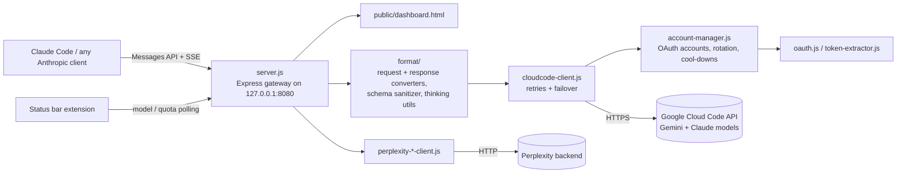

<p align="center">
  
</p>

<p align="center"><strong>Run Claude Code on Gemini, Claude and Perplexity models through one local, Anthropic-compatible endpoint.</strong></p>

<p align="center">
  <a href="LICENSE"></a>
  
  <a href="https://github.com/muhib-karim/Antigravity-Claude-Code-Proxy/actions/workflows/ci.yml"></a>
  <a href="https://open-vsx.org/extension/ai-dev-2024/claude-proxy-status"></a>
</p>

<p align="center">
  <a href="https://muhib-karim.github.io/Antigravity-Claude-Code-Proxy/">Website</a> •
  <a href="#quick-start">Quick start</a> •
  <a href="#usage">Usage</a> •
  <a href="#architecture">Architecture</a> •
  <a href="#testing">Testing</a>
</p>

Based on [antigravity-claude-proxy](https://github.com/badrisnarayanan/antigravity-claude-proxy) by Badri Narayanan S (MIT License).

---

## What it is

Antigravity Claude Code Proxy is a local Node.js/Express gateway. It speaks the **Anthropic Messages API** (`/v1/messages`, with SSE streaming), so Claude Code and other Anthropic clients only need `ANTHROPIC_BASE_URL` pointed at it. It translates each request into the format the upstream provider expects, sends it with the signed-in account it picked, and translates the response (text, tool calls and thinking blocks) back.

### Key features

- **Anthropic-compatible API**: `/v1/messages` (streaming and non-streaming), `/v1/messages/count_tokens` and `/v1/models`.
- **Two-way format translation** (`src/format/`): messages, system prompts, images/documents, tool calls and results, and thinking blocks with signature handling. Also includes a JSON-schema sanitizer for tool definitions the Cloud Code API would otherwise reject.
- **Multi-account handling**: Google accounts added through OAuth are stored owner-only (`0600`). Requests use a sticky account for caching, accounts are rotated with cool-downs when rate-limited, and requests fail over when a token refresh fails.
- **Model routing**: 37 built-in short aliases (`flash`, `pro`, `opus`, …), a global model override (`/active-model`), and per-session models via the `X-Session-ID` header (`/session-model`).
- **Web dashboard** at `/dashboard`: accounts, quotas, usage per model, sessions and model switching.
- **Local-only by default**: binds to `127.0.0.1` and refuses foreign `Origin` headers and DNS-rebinding style `Host` headers.
- **CLI** (`bin/cli.js`): start the server and manage accounts (`add`, `list`, `remove`, `verify`, `clear`). `scripts/doctor.js` runs a setup self-check.
- **Status bar extension** for VS Code-based editors, [published on Open VSX](https://open-vsx.org/extension/ai-dev-2024/claude-proxy-status). It shows the active model and quotas and allows one-click switching.

> **Verification scope.** CI runs lint and offline tests on Node 20 and 22 using mocked upstreams, plus secret scanning and a runtime dependency audit. Those checks do not establish current access to every remote model or account. Provider names and model identifiers can change; verify the configured provider before relying on it.
>
> The gateway runs locally, but prompts and code sent for inference are forwarded to the configured provider. Account credentials, OAuth setup and provider quotas are your responsibility. Do not publish credentials, logs with tokens, or real account screenshots in a public issue. A static showcase or mocked test is not a live-provider benchmark.

### Demo

Real output from this repository, rendered to SVG (CLI help plus the offline test run):

<p align="center"></p>

<details>
<summary>Dashboard and status bar screenshots</summary>

<p align="center">
  <br><em>Web dashboard</em><br><br>
  <br><em>Quota popup in the status bar extension</em><br><br>
  <br><em>Model switcher</em><br><br>
  <br><em>Active model in the editor status bar</em>
</p>
</details>

---

## Quick start

**Requirements:** Node.js 18+ (CI tests on Node 20 and 22), and the [Claude Code CLI](https://www.npmjs.com/package/@anthropic-ai/claude-code). [PM2](https://pm2.keymetrics.io/) is optional, for running the proxy in the background.

```bash
git clone https://github.com/muhib-karim/Antigravity-Claude-Code-Proxy.git
cd Antigravity-Claude-Code-Proxy/Antigravity-Claude-Code-Proxy   # the npm package lives in this folder

# PUPPETEER_SKIP_DOWNLOAD skips Chromium, which only Perplexity browser login needs
PUPPETEER_SKIP_DOWNLOAD=true npm ci

npm start                                  # foreground, http://127.0.0.1:8080
curl http://localhost:8080/health          # from another terminal
```

### Add a Google account

Google sign-in needs an OAuth client secret. It is **not** stored in this repository. Set it in your shell or in a `.env` file next to `package.json` (see `.env.example` for every setting):

```bash
export GOOGLE_OAUTH_CLIENT_SECRET="<your OAuth client secret>"
export GOOGLE_OAUTH_CLIENT_ID="<your OAuth client id>"   # optional, for your own OAuth app

npm run accounts:add     # opens a Google sign-in in your browser (needs a desktop browser)
npm run accounts:list
```

With no account configured the proxy still starts and `/health` answers, but `/v1/messages` returns a clear "No accounts available" error.

### Point Claude Code at the proxy

```bash
export ANTHROPIC_BASE_URL="http://localhost:8080"
export ANTHROPIC_API_KEY="antigravity-proxy"
claude
```

On Windows (PowerShell, not verified in CI):

```powershell
[Environment]::SetEnvironmentVariable("ANTHROPIC_BASE_URL", "http://localhost:8080", "User")
[Environment]::SetEnvironmentVariable("ANTHROPIC_API_KEY", "antigravity-proxy", "User")
```

Optional background service: `pm2 start src/index.js --name antigravity-proxy && pm2 save`. The Windows batch helpers in `scripts/setup/` (PM2 registration, start-up on login) are Windows-only and are not verified in CI.

---

## Usage

```bash
node bin/cli.js --help          # CLI usage
node bin/cli.js start           # same as npm start; PORT=3000 to change the port
node bin/cli.js accounts verify # check stored tokens
npm run doctor                  # setup self-check
```

Switch models from Claude Code with `/model <name or alias>`, or from the dashboard at `http://localhost:8080/dashboard`:

| Alias | Resolves to | Notes |
|-------|-------------|-------|
| `flash`, `fast`, `haiku` | `gemini-3-flash` | Agentic (tool use) |
| `pro`, `strong` | `gemini-3-pro-high` | Agentic |
| `thinking` | `gemini-2.5-flash-thinking` | Agentic |
| `claude-opus`, `claude-sonnet` | `claude-opus-4-5-thinking`, `claude-sonnet-4-5-thinking` | Agentic, via Google Cloud Code |
| `opus`, `sonnet`, `grok`, `kimi`, `gpt` | `pplx-*` models | Perplexity, chat only (no tool use) |
| `sonar`, `research` | `sonar`, `sonar-deep-research` | Perplexity web search, chat only |

The full alias table is `MODEL_ALIASES` in [`src/constants.js`](Antigravity-Claude-Code-Proxy/src/constants.js). The model list from `/v1/models` is fetched live from the configured accounts.

### Main endpoints

| Endpoint | Method | Purpose |
|----------|--------|---------|
| `/v1/messages` | POST | Anthropic Messages API (JSON or SSE) |
| `/v1/messages/count_tokens` | POST | Token counting |
| `/v1/models` | GET | Active model plus models available to the configured accounts |
| `/active-model` | GET / POST / DELETE | Global model override |
| `/session-model` | POST (`/:sessionId` GET / DELETE) | Per-session model |
| `/account-limits`, `/model-usage`, `/sessions` | GET | Quotas, usage and sessions for the dashboard |
| `/dashboard` | GET | Web dashboard |
| `/health` | GET | Health check |

### Configuration

| Variable | Default | Purpose |
|----------|---------|---------|
| `PORT` | `8080` | HTTP port |
| `HOST` | `127.0.0.1` | Bind address. The proxy has no authentication, so only use `0.0.0.0` if you really want other machines to reach it |
| `ACCOUNT_CONFIG_PATH` | `~/.config/antigravity-proxy/accounts.json` | Google account store |
| `PROXY_STATE_DIR` | package folder | Where `logs/`, `model-override.json` and `session-models.json` are written |
| `CORS_ALLOWED_ORIGINS` | *(empty)* | Extra comma-separated browser origins (localhost and editor webviews are always allowed) |
| `GOOGLE_OAUTH_CLIENT_SECRET` | *(none)* | Required for Google sign-in and token refresh |
| `GOOGLE_OAUTH_CLIENT_ID` | built-in client id | For your own OAuth app |
| `CLOUDCODE_ENDPOINTS` | Google Cloud Code endpoints | Comma-separated upstream override (the tests point this at a mock server) |

---

## Architecture



- `src/index.js` starts `src/server.js`, the Express app with all routes, CORS/Host checks and model routing.
- `src/format/` converts Anthropic requests into Google Generative AI `contents`/`parts` and converts responses and SSE streams back. This includes tool calls, thinking signatures (with an in-memory signature cache) and recovery when a tool loop has lost its thinking blocks.
- `src/cloudcode-client.js` calls the upstream with retries and endpoint fallback. `src/account-manager.js` picks the account, refreshes tokens and backs off from rate-limited accounts.
- Perplexity models go through the `perplexity-*` clients. They are served by a separate Python server on `localhost:8000` that is **not part of this repository**, so they are not covered by the tests.

---

## Testing

Run from the package folder. These are the same steps CI runs ([`.github/workflows/ci.yml`](.github/workflows/ci.yml)):

```bash
cd Antigravity-Claude-Code-Proxy
PUPPETEER_SKIP_DOWNLOAD=true npm ci
npm run lint          # ESLint: errors fail the build, warnings are reported
npm test              # 50 offline tests (Node's built-in test runner)
npm audit --package-lock-only --omit=dev --audit-level=high
```

`npm test` needs no accounts, keys or network. It covers:

- **Server integration**: starts the real proxy on a free port with a temporary home folder and a mock Cloud Code upstream. Covers `/health`, `/v1/models`, streaming and non-streaming `/v1/messages`, tool calls, per-session models, the no-account error path, model-switch endpoints, cross-origin and DNS-rebinding blocking, override persistence across restarts, and account rotation when a token refresh fails.
- **Unit tests**: request/response converters, content-to-parts conversion, the thoughtSignature cache, thinking-block filtering and tool-loop recovery, schema sanitizing, model aliases and error classes.
- **CLI smoke tests**: `--help`, `--version` and unknown-command handling of `bin/cli.js`.

The older end-to-end scripts talk to real models. They need a running proxy with at least one account and are not part of `npm test`: run `npm start` in one terminal and `npm run test:live` in another.

---

## Project structure

```
.
├── Antigravity-Claude-Code-Proxy/   # The npm package (run npm commands here)
│   ├── bin/cli.js                   # CLI entry point
│   ├── src/
│   │   ├── index.js                 # Starts the HTTP server
│   │   ├── server.js                # Express app and routes
│   │   ├── cloudcode-client.js      # Upstream client with retries/failover
│   │   ├── account-manager.js       # Multi-account handling
│   │   ├── format/                  # Anthropic <-> Google converters
│   │   ├── perplexity-*.js          # Perplexity clients and session managers
│   │   ├── constants.js             # Config and model aliases
│   │   └── public/dashboard.html    # Web dashboard
│   ├── scripts/                     # doctor.js, Perplexity login helpers
│   └── tests/
│       ├── smoke/                   # Offline tests run by `npm test`
│       └── *.cjs                    # Live tests run by `npm run test:live`
├── docs/                            # Setup guides, banner, demo, screenshots
├── site/                            # GitHub Pages site
├── scripts/setup/                   # Windows setup helpers (.bat)
├── bin/claude-session.{sh,bat}      # Session launcher helpers
└── .github/workflows/               # CI, Pages, release workflows
```

---

## Security

- The OAuth client secret comes from `GOOGLE_OAUTH_CLIENT_SECRET`. Older revisions embedded one that the upstream project publishes; it is no longer in the source and is allow-listed in `.gitleaksignore` for history scans.
- Account files are written with owner-only permissions. `.env`, account, token and log files are git-ignored.
- The headless-browser stack (Puppeteer) is an optional peer dependency used only by Perplexity browser login. The default install has no known advisories, and CI runs `npm audit` plus a full-history gitleaks scan.

See [SECURITY.md](SECURITY.md) for the full policy.

## Limitations and roadmap

- Live provider access (Google Cloud Code, Perplexity) is not exercised in CI; only mocked upstreams are.
- The Perplexity backend is a separate server that is not included here.
- The Windows setup scripts and PowerShell steps are not verified in CI.
- The status bar extension source (`claude-proxy-ext-src`) is referenced as a git submodule without a `.gitmodules` entry, so it is not checked out with this repository.

See [CHANGELOG.md](CHANGELOG.md) for version history.

## License

MIT. See [LICENSE](LICENSE). Built on [antigravity-claude-proxy](https://github.com/badrisnarayanan/antigravity-claude-proxy) by Badri Narayanan S, used under the MIT License. The original copyright notice is kept in the license.

<p align="center">
  <a href="https://github.com/muhib-karim/Antigravity-Claude-Code-Proxy/issues">Report a bug</a> •
  <a href="https://ko-fi.com/ai_dev_2024">Support on Ko-fi</a> •
  <a href="https://startup.z.ai/">Part of the ZAI Start-up Community</a>
</p>
